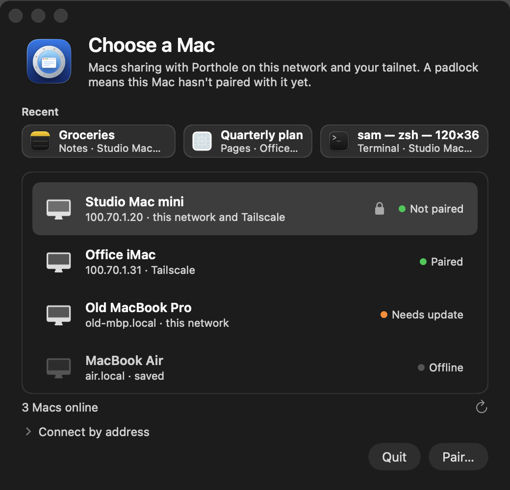
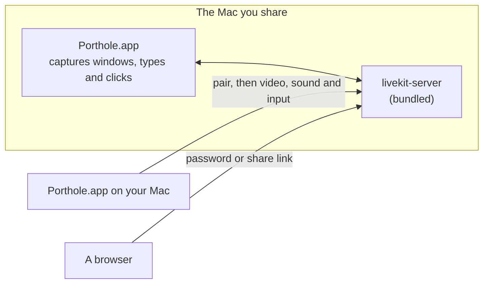

# Porthole

Use another Mac's windows as if they were on the Mac in front of you.

> **Early release (0.1.0).** Porthole is checked by its automated tests, but the newest pairing and connection code has not been tried between real Macs yet. Expect rough edges, and please report what you find.

<p align="center"></p>

Porthole shares single windows, not the whole desktop: each one opens as its own window on your Mac, with its own Dock icon, sharp on a Retina screen, at up to 60 frames a second. Type, click, scroll and resize, and the real window on the other Mac follows. A browser on any computer or phone works as a viewer too.

- **One window at a time, or the whole screen.** Open as many windows as you like, each in its own portal, or pick "This Mac's Screen".
- **Feels local.** Keyboard shortcuts, dictation, input methods, clipboard both ways, and sound from the shared app.
- **Works without a screen.** A headless Mac gets a virtual display sized to your screen while you are connected.
- **Pair once.** A 6-digit code shown on the Mac you share pairs another Mac for good. You can unpair it at any time.
- **Unlock from afar.** If the shared Mac is locked, type its login password in the viewer.
- **Share a link.** Give someone a browser link to one window, view-only or with control, that expires by itself.
- **Stays up.** A small watchdog restarts Porthole if it crashes or hangs.

## How it works



The same app runs on both Macs. On the Mac you share, turn on **Share this Mac**; it then captures each window with ScreenCaptureKit, sends it as HEVC or H.264 through a LiveKit server that runs inside the app, and replays your keyboard and mouse. Macs find each other with Bonjour on the same network and through Tailscale across networks. More detail is in [docs/design.md](docs/design.md).

## Requirements

- An Apple Silicon Mac with macOS 14 or later, on both ends.
- Swift 5.10 or later (Xcode 15.3 or its Command Line Tools).
- `brew install livekit` (the server is copied into the app).
- Node 20 or later, only for the web tests.

## Install

```sh
scripts/bundle.sh && cp -R dist/Porthole.app /Applications/
scripts/install-cli.sh
```

`install-cli.sh` links `porthole` into `~/bin` or `/usr/local/bin`; pass `--dir DIR` for another folder on your PATH.

On the Mac you share: allow **Screen Recording** and **Accessibility**, then turn on **Settings › Sharing › Share this Mac**. macOS also asks once to let Porthole find devices on your local network; allow it, or other Macs on the same network won't see this one.

The app is signed with a certificate named "Porthole Dev" if your keychain has one, and ad hoc otherwise. With ad hoc signing macOS asks for the two permissions again after every rebuild, so a self-signed code-signing certificate with that name saves time.

## Use

- **Pair:** pick the Mac in the Connect window and type the 6-digit code it shows.
- **Open a window:** pick it from the list.
- **Whole screen:** pick "This Mac's Screen".
- **Locked Mac:** click **Unlock…** and type its password.
- **Browser:** open `http://<mac>:7878` and enter the password from the menu (**Copy Password**).
- **Share a link:** menu › **Share Window…**.

## Commands

```sh
porthole doctor          # check everything on this Mac
porthole machines        # Macs that share with Porthole
porthole ls <mac>        # a Mac's windows
porthole open <mac> <window>
porthole share [window]  # make a browser link
porthole log -f          # follow the logs
porthole env             # every setting
```

`porthole help` lists the rest.

## Security

- Pairing uses the 6-digit code in a key exchange; the code and the pairing secret are never sent over the network. A paired Mac proves itself with that secret, and the host's answer is sealed with it, so a fake host on the network gets nothing.
- Video, sound, input and clipboard travel over WebRTC, which is encrypted.
- A share link shows only its window. A link with control can type and click only in that window, and system shortcuts are blocked.
- Porthole's own web page and the connection set-up use plain HTTP on port 7878. On a network you don't trust, someone who can read the traffic could see the browser password or take over a session for a few minutes. Use Tailscale, which encrypts everything between your machines, when you are not at home.
- Keep the browser password to yourself: it gives full control of the shared windows.

Found a security problem? Please open a private security advisory on GitHub instead of a public issue.

## Develop

```sh
swift build
scripts/test.sh
scripts/deploy.sh   # install on another Mac over SSH; see --help
```

There are no code comments by convention; names and tests carry the meaning.

## Licence

MIT, see [LICENSE](LICENSE). Third-party software is listed in [THIRD_PARTY.md](THIRD_PARTY.md).
